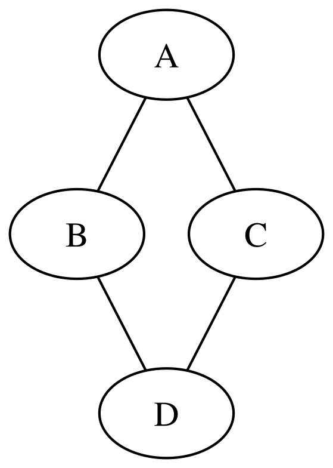
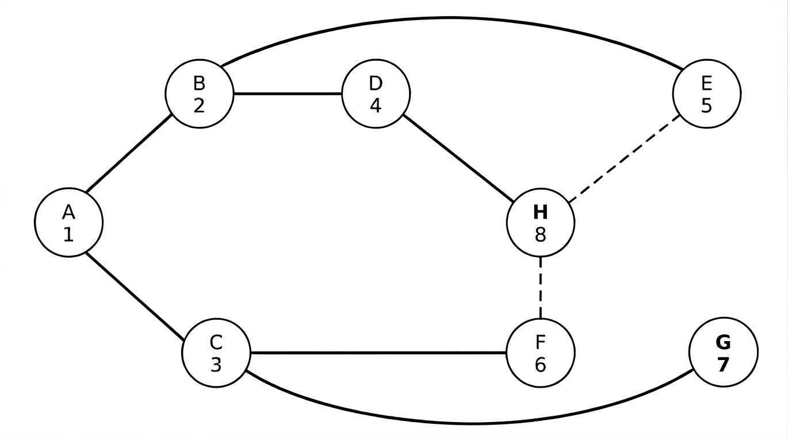

# Grafos

Un grafo es una estructura matemática que permite representar
relaciones entre objetos. Está formado por:

- Un conjunto de *nodos* (*nodes*), que representan los objetos.
  También se denominan vértices (*vertices*; en singular,
  *vertex*).

- Un conjunto de *aristas* (*edges*), que representan las
  relaciones entre los nodos. En un grafo no dirigido, las
  aristas no tienen orientación; en un grafo dirigido, las
  conexiones tienen un sentido determinado y suelen denominarse
  *arcos* (*arcs*).

Por ejemplo, en una red de comunicaciones, los nodos pueden
representar ordenadores y las aristas, las conexiones entre
ellos. En un mapa de carreteras, los nodos pueden representar
ciudades y las aristas, las carreteras que las conectan.

Los grafos pueden clasificarse según las características de sus
aristas:

- Grafos no dirigidos: las aristas representan relaciones
  bidireccionales. Si existe una arista entre dos nodos, podemos
  recorrerla en ambos sentidos.
- Grafos dirigidos: las aristas tienen un sentido determinado.
  Una arista que va de un nodo a otro no implica necesariamente
  que exista una arista en sentido contrario.
- Grafos ponderados: las aristas tienen asociado un valor
  numérico, denominado peso, que puede representar una distancia,
  un coste o un tiempo de recorrido.

Un mismo grafo puede ser dirigido o no dirigido y, además, estar
ponderado.

Otra clasificación de los grafos se basa en su conectividad.
Simplificando un poco, podemos distinguir dos tipos:

- Grafos conexos: existe un camino entre cualquier par de nodos.
- Grafos no conexos: existen al menos dos nodos entre los que no
  hay ningún camino.

Esta definición es válida directamente para grafos no dirigidos.
En los grafos dirigidos, la conectividad tiene algunos matices
adicionales que no trataremos aquí.

En el procesamiento de grafos se plantean problemas como
determinar si existe un camino entre dos nodos, recorrer todos
los nodos alcanzables desde uno dado o encontrar el camino de
menor coste entre dos nodos. Los algoritmos estudiados en este
tema permiten resolver algunos de estos problemas.

## Representación de grafos

Existen diferentes formas de representar un grafo en un programa.
Una de las más habituales es la lista de adyacencia, que asocia a
cada nodo la lista de nodos con los que está conectado.

Por ejemplo, consideremos este grafo no dirigido con cuatro
nodos.



Sus aristas son:

- A — B
- A — C
- B — D
- C — D

Su lista de adyacencia es:

| Nodo | Vecinos |
|------|---------|
| A    | B, C    |
| B    | A, D    |
| C    | A, D    |
| D    | B, C    |

En un grafo no dirigido, cada arista aparece en las listas de
adyacencia de sus dos extremos. En un grafo dirigido, cada nodo
contiene únicamente los destinos de las aristas que salen de él.

En Rust, podemos representar un grafo mediante un vector de
vectores (Vec\<Vec<usize>\>), cuya estructura coincide con la de
una lista de adyacencia. Cada posición del vector principal
corresponde a un nodo, y el vector interior contiene los índices
de sus nodos vecinos. Aunque existen otras formas de representar
grafos, esta es una alternativa sencilla y muy utilizada.

Por ejemplo, el grafo anterior se puede representar así:

``` rust
fn main() {
    let grafo = vec![
        vec![1, 2], // Nodo A
        vec![0, 3], // Nodo B
        vec![0, 3], // Nodo C
        vec![1, 2], // Nodo D
    ];

    for (nodo, vecinos) in grafo.iter().enumerate() {
        println!("{nodo}: {vecinos:?}");
    }
}
```

En este ejemplo, los nodos se identifican mediante los números
`0`, `1`, `2` y `3`, que son los índices del vector principal,
correspondientes a A, B, C y D, respectivamente.

La lista de adyacencia resulta especialmente adecuada para los
recorridos de grafos, ya que permite obtener directamente los
vecinos de cada vértice. Además, evita almacenar las conexiones
que no existen, algo importante cuando el grafo tiene muchos
vértices y pocas aristas.

Cuando las aristas tienen pesos, cada vecino debe almacenarse
junto con el peso de la conexión. Por ejemplo, podemos utilizar
una tupla `(usize, u32)` para representar el índice del vértice
vecino y el peso de la arista.

## Recorridos de grafos

Recorrer un grafo consiste en visitar sus nodos siguiendo sus
conexiones. Estos recorridos permiten explorar la estructura del
grafo y resolver problemas como comprobar si existe un camino
entre dos nodos, localizar nodos que cumplen determinadas
condiciones o construir un árbol de expansión.

Hay diferentes algoritmos para recorrer un grafo. Los dos
principales son:

- Búsqueda en anchura (*Breadth-First Search*, BFS).
- Búsqueda en profundidad (*Depth-First Search*, DFS).

Existen otras variantes que no trataremos aquí, como la búsqueda
en profundidad limitada, la búsqueda en profundidad iterativa y
la búsqueda bidireccional.

### Búsqueda en anchura

{width=70%}

La búsqueda en anchura (*Breadth-First Search*, BFS) es un
algoritmo que recorre un grafo visitando primero los nodos más
próximos al nodo inicial. Para ello, utiliza una cola, en la que
los nodos se procesan en el mismo orden en que se descubren.

#### Algoritmo

El procedimiento puede resumirse así:

1.  Se parte de un nodo inicial, se marca como visitado y se
    introduce en la cola.
2.  Se extrae el primer nodo de la cola y se examinan sus
    vecinos.
3.  Cada vecino que todavía no haya sido visitado se marca como
    visitado y se añade al final de la cola.
4.  Se repite el proceso hasta que la cola queda vacía.

La cola sigue el criterio FIFO (*First In, First Out*): el primer
elemento que entra es el primero que sale. Esto permite explorar
los nodos por niveles de distancia creciente respecto al nodo
inicial.

Si el grafo no es conexo, el recorrido iniciado en un único nodo
no alcanzará necesariamente todos sus nodos. Para recorrerlos
todos, habría que iniciar nuevas búsquedas desde los nodos que
aún no se hayan visitado.

#### Los vecinos no están ordenados

Es importante tener en cuenta que los vecinos de un nodo no están
ordenados. Diferentes implementaciones podrán hacer distintos
recorridos, todos ello correctos. En la búsqueda en anchura, lo
importante es que primero se recorran todos los nodos de un
nivel, en cualquier orden, y luego se pase al nivel siguiente.

En el grafo del ejemplo, comenzando por el nodo A, los niveles
son los siguientes:

Nivel 0: A

Nivel 1: B, C

Nivel 2: D, E, F, G

Nivel 3: H

Por tanto, el recorrido podría empezar por A, B, C o por A, C, B.
A continuación, se recorrerán los nodos D, E, F y G, en cualquier
orden, y finalmente el nodo H, que es el único del nivel 3.

### Implementación de la búsqueda en anchura

Esta es una implementación en Rust de la búsqueda en anchura

``` rust

```

::: {.text-end .small}

[Ejecutar▶](https://play.rust-lang.org/?version=stable&mode=debug&edition=2024&code=use%20std%3A%3Acollections%3A%3AVecDeque%3B%0A%0Afn%20busca_anchura%28grafo%3A%20%26%5BVec%3Cusize%3E%5D%2C%20inicio%3A%20usize%29%20%7B%0A%20%20%20%20let%20mut%20visitado%20%3D%20vec%21%5Bfalse%3B%20grafo.len%28%29%5D%3B%0A%20%20%20%20let%20mut%20cola%20%3D%20VecDeque%3A%3Anew%28%29%3B%0A%0A%20%20%20%20visitado%5Binicio%5D%20%3D%20true%3B%0A%20%20%20%20cola.push_back%28inicio%29%3B%0A%0A%20%20%20%20while%20let%20Some%28nodo%29%20%3D%20cola.pop_front%28%29%20%7B%0A%20%20%20%20%20%20%20%20print%21%28%22%7B%7D%20%22%2C%20%28b%27A%27%20%2B%20nodo%20as%20u8%29%20as%20char%29%3B%0A%0A%20%20%20%20%20%20%20%20for%20%26vecino%20in%20%26grafo%5Bnodo%5D%20%7B%0A%20%20%20%20%20%20%20%20%20%20%20%20if%20%21visitado%5Bvecino%5D%20%7B%0A%20%20%20%20%20%20%20%20%20%20%20%20%20%20%20%20visitado%5Bvecino%5D%20%3D%20true%3B%0A%20%20%20%20%20%20%20%20%20%20%20%20%20%20%20%20cola.push_back%28vecino%29%3B%0A%20%20%20%20%20%20%20%20%20%20%20%20%7D%0A%20%20%20%20%20%20%20%20%7D%0A%20%20%20%20%7D%0A%7D%0A%0Afn%20main%28%29%20%7B%0A%20%20%20%20//%20A%20%3D%200%2C%20B%20%3D%201%2C%20C%20%3D%202%2C%20...%2C%20H%20%3D%207%0A%20%20%20%20let%20grafo%20%3D%20vec%21%5B%0A%20%20%20%20%20%20%20%20vec%21%5B1%2C%202%5D%2C%20%20%20%20%20%20%20//%20A%3A%20B%2C%20C%0A%20%20%20%20%20%20%20%20vec%21%5B0%2C%203%2C%204%5D%2C%20%20%20%20//%20B%3A%20A%2C%20D%2C%20E%0A%20%20%20%20%20%20%20%20vec%21%5B0%2C%205%2C%206%5D%2C%20%20%20%20//%20C%3A%20A%2C%20F%2C%20G%0A%20%20%20%20%20%20%20%20vec%21%5B1%2C%207%5D%2C%20%20%20%20%20%20%20//%20D%3A%20B%2C%20H%0A%20%20%20%20%20%20%20%20vec%21%5B1%2C%207%5D%2C%20%20%20%20%20%20%20//%20E%3A%20B%2C%20H%0A%20%20%20%20%20%20%20%20vec%21%5B2%2C%207%5D%2C%20%20%20%20%20%20%20//%20F%3A%20C%2C%20H%0A%20%20%20%20%20%20%20%20vec%21%5B2%5D%2C%20%20%20%20%20%20%20%20%20%20//%20G%3A%20C%0A%20%20%20%20%20%20%20%20vec%21%5B3%2C%204%2C%205%5D%2C%20%20%20%20//%20H%3A%20D%2C%20E%2C%20F%0A%20%20%20%20%5D%3B%0A%0A%20%20%20%20println%21%28%22Recorrido%20en%20anchura%3A%22%29%3B%0A%20%20%20%20busca_anchura%28%26grafo%2C%200%29%3B%0A%20%20%20%20println%21%28%29%3B%0A%7D%0A)

:::

La función `busca_anchura` recibe el grafo y el índice del nodo
desde el que comienza la búsqueda.

- Utiliza dos estructuras de datos auxiliares:

  - Un vector `visitado`, que indica qué nodos ya han sido
    descubiertos.
  - Una cola `VecDeque`, que almacena los nodos pendientes de
    explorar.

- Inicialmente, se marca el nodo de partida como visitado y se
  introduce en la cola.

- A continuación, mientras la cola no esté vacía, se extrae el
  primer nodo mediante `pop_front()` y se muestra su letra por
  pantalla. Después, se examinan sus vecinos. Cada vecino que
  todavía no haya sido visitado se marca como visitado y se añade
  al final de la cola mediante `push_back()`.

- Es importante marcar cada nodo como visitado cuando se
  introduce en la cola, y no cuando se extrae de ella. De este
  modo, se evita añadir varias veces el mismo nodo cuando existen
  distintas conexiones que conducen a él.

- La cola sigue el criterio FIFO (*First In, First Out*): los
  nodos se procesan en el mismo orden en que se descubren. Esto
  permite explorar el grafo por niveles de distancia creciente
  respecto al nodo inicial.

En el ejemplo, la búsqueda comienza en A y obtiene el orden de
visita A, B, C, D, E, F, G, H.

Esta función solo recorre los nodos alcanzables desde el nodo
inicial. Si el grafo no es conexo, habría que iniciar nuevas
búsquedas desde los nodos que aún no se hayan visitado para
recorrer todos sus componentes.

### Búsqueda en profundidad

{width=70%}

La búsqueda en profundidad (*Depth-First Search*, DFS) explora un
grafo avanzando por un camino hasta que no puede continuar. En
ese momento, retrocede hasta encontrar un nodo desde el que pueda
explorar una conexión todavía no visitada.

Para evitar visitar varias veces un mismo nodo, el algoritmo
marca los nodos que ya ha visitado.

El procedimiento puede resumirse así:

1.  Se parte de un nodo inicial y se marca como visitado.
2.  Se elige uno de sus vecinos que todavía no haya sido visitado
    y se continúa la búsqueda desde él.
3.  Cuando no quedan vecinos sin visitar, se retrocede al nodo
    anterior.
4.  El proceso termina cuando ya no quedan nodos pendientes de
    explorar desde el nodo inicial.

El recorrido puede implementarse mediante recursividad o
utilizando una pila explícita. En ambos casos, la idea
fundamental es explorar primero un camino hasta donde sea posible
antes de regresar para explorar otros.

El orden exacto de visita depende del orden en que se examinen
los vecinos de cada nodo, por lo que un mismo grafo puede dar
lugar a distintos recorridos DFS.

Al igual que en la búsqueda en anchura, si el grafo no es conexo,
un recorrido iniciado en un único nodo no alcanzará
necesariamente todos los nodos del grafo. Para recorrerlos todos,
habría que iniciar nuevas búsquedas desde los nodos que aún no se
hayan visitado.

### Los vecinos no están ordenados

Al igual que sucede en la búsqueda en anchura, diferentes
implementaciones pueden producir distintos órdenes de visita,
dependiendo del orden en que se examinen los vecinos de cada
nodo.

Todos estos recorridos son correctos siempre que se respete la
estrategia de la búsqueda en profundidad: al llegar a un nodo,
pasamos a uno de sus vecinos que todavía no hayamos visitado y,
desde allí, seguimos recorriendo en profundidad. Cuando ya no
quedan vecinos sin visitar, retrocedemos al nodo anterior y
continuamos la exploración.

### Implementación de la búsqueda en profundidad

Esta es una implementación recursiva en Rust de la búsqueda en
profundidad

``` rust

```

::: {.text-end .small}

[Ejecutar▶](https://play.rust-lang.org/?version=stable&mode=debug&edition=2024&code=fn%20busca_profundidad%28grafo%3A%20%26%5BVec%3Cusize%3E%5D%2C%20nodo%3A%20usize%2C%20visitado%3A%20%26mut%20%5Bbool%5D%29%20%7B%0A%20%20%20%20visitado%5Bnodo%5D%20%3D%20true%3B%0A%20%20%20%20print%21%28%22%7B%7D%20%22%2C%20%28b%27A%27%20%2B%20nodo%20as%20u8%29%20as%20char%29%3B%0A%0A%20%20%20%20for%20%26vecino%20in%20%26grafo%5Bnodo%5D%20%7B%0A%20%20%20%20%20%20%20%20if%20%21visitado%5Bvecino%5D%20%7B%0A%20%20%20%20%20%20%20%20%20%20%20%20busca_profundidad%28grafo%2C%20vecino%2C%20visitado%29%3B%0A%20%20%20%20%20%20%20%20%7D%0A%20%20%20%20%7D%0A%7D%0A%0Afn%20main%28%29%20%7B%0A%20%20%20%20//%20A%20%3D%200%2C%20B%20%3D%201%2C%20C%20%3D%202%2C%20...%2C%20H%20%3D%207%0A%20%20%20%20let%20grafo%20%3D%20vec%21%5B%0A%20%20%20%20%20%20%20%20vec%21%5B1%2C%202%5D%2C%20%20%20%20%20%20%20//%20A%3A%20B%2C%20C%0A%20%20%20%20%20%20%20%20vec%21%5B0%2C%203%2C%204%5D%2C%20%20%20%20//%20B%3A%20A%2C%20D%2C%20E%0A%20%20%20%20%20%20%20%20vec%21%5B0%2C%205%2C%206%5D%2C%20%20%20%20//%20C%3A%20A%2C%20F%2C%20G%0A%20%20%20%20%20%20%20%20vec%21%5B1%2C%207%5D%2C%20%20%20%20%20%20%20//%20D%3A%20B%2C%20H%0A%20%20%20%20%20%20%20%20vec%21%5B1%2C%207%5D%2C%20%20%20%20%20%20%20//%20E%3A%20B%2C%20H%0A%20%20%20%20%20%20%20%20vec%21%5B2%2C%207%5D%2C%20%20%20%20%20%20%20//%20F%3A%20C%2C%20H%0A%20%20%20%20%20%20%20%20vec%21%5B2%5D%2C%20%20%20%20%20%20%20%20%20%20//%20G%3A%20C%0A%20%20%20%20%20%20%20%20vec%21%5B3%2C%204%2C%205%5D%2C%20%20%20%20//%20H%3A%20D%2C%20E%2C%20F%0A%20%20%20%20%5D%3B%0A%0A%20%20%20%20let%20mut%20visitado%20%3D%20vec%21%5Bfalse%3B%20grafo.len%28%29%5D%3B%0A%0A%20%20%20%20println%21%28%22Recorrido%20en%20profundidad%3A%22%29%3B%0A%20%20%20%20busca_profundidad%28%26grafo%2C%200%2C%20%26mut%20visitado%29%3B%0A%20%20%20%20println%21%28%29%3B%0A%7D%0A)

:::

- La función `busca_profundidad` recibe el grafo, el índice del
  nodo desde el que continúa la búsqueda y un vector que indica
  qué nodos han sido visitados.

- Al comenzar, marca el nodo actual como visitado y muestra su
  letra por pantalla. A continuación, examina sus vecinos. Si
  alguno todavía no ha sido visitado, llama recursivamente a
  `dfs` para continuar la búsqueda desde ese nodo.

- El vector `visitado` evita que el algoritmo vuelva a explorar
  un nodo que ya ha sido descubierto. Esto es necesario porque un
  grafo puede contener ciclos.

- La función utiliza recursividad para gestionar el retroceso:
  cuando un nodo no tiene vecinos pendientes de explorar, su
  llamada termina y la ejecución continúa en la llamada anterior,
  que puede examinar otros vecinos.

- En `main`, el grafo se representa mediante una lista de
  adyacencia. Cada nodo se identifica con un índice entre 0 y 7,
  que corresponde a las letras A–H. Como el grafo es no dirigido,
  cada arista aparece en las listas de adyacencia de sus dos
  extremos.

En el ejemplo que estamos utilizando, la búsqueda comienza en A,
cuyo índice es 0. El orden de visita obtenido es A, B, D, H, E,
F, C, G.

Esta implementación recorre únicamente los nodos alcanzables
desde el nodo inicial. Si el grafo no es conexo, sería necesario
iniciar nuevas búsquedas desde los nodos que aún no se hayan
visitado para recorrer todos sus componentes.

### Comparación entre búsqueda en anchura y búsqueda en profundidad

La búsqueda en profundidad (DFS) y la búsqueda en anchura (BFS)
permiten recorrer los nodos de un grafo, pero siguen estrategias
diferentes.

En DFS, se avanza por un camino hasta que no quedan vecinos sin
visitar. En ese momento, se retrocede para explorar otras
posibilidades. Su implementación puede utilizar recursividad o
una pila.

En BFS, se exploran primero los vecinos del nodo inicial y, a
continuación, los vecinos de estos, siguiendo un orden por
niveles. Para ello, se utiliza una cola FIFO.

Las principales diferencias son las siguientes:

| Característica | Busc. Anchura | Busc. Profundidad |
|----|----|----|
| Estrategia | Explora los nodos por niveles de distancia creciente. | Explora un camino hasta donde sea posible antes de retroceder. |
| Estructura de datos habitual | Cola FIFO. | Pila o recursividad. |
| Caminos mínimos | Encuentra caminos con el menor número de aristas en grafos no ponderados. | No garantiza encontrar el camino con menos aristas. |
| Uso de memoria | Puede necesitar bastante memoria si hay muchos nodos en un mismo nivel. | Puede necesitar menos memoria, aunque depende de la estructura del grafo. |
| Aplicaciones típicas | Búsqueda de caminos mínimos en grafos no ponderados y exploración por niveles. | Detección de componentes conexos, exploración de laberintos y análisis de ciclos. |

Ambos algoritmos tienen una complejidad temporal de (O(V+E)),
donde (V) es el número de nodos y (E) el número de aristas,
siempre que el grafo se represente mediante listas de adyacencia
y cada nodo y arista se procese un número constante de veces.

Ninguno de los dos algoritmos garantiza visitar todos los nodos
si el grafo no es conexo y la búsqueda comienza en un único nodo.
Para recorrer todos los componentes, es necesario iniciar nuevas
búsquedas desde los nodos que todavía no se hayan visitado.

### Uso de una biblioteca para realizar recorridos

Existen bibliotecas que proporcionan estructuras de datos y
algoritmos para trabajar con grafos, evitando tener que
implementarlos desde cero. Una de las más conocidas es
[`petgraph`](https://docs.rs/petgraph/), que permite representar
grafos dirigidos y no dirigidos, recorrer sus nodos y aristas y
aplicar algoritmos como la búsqueda de caminos mínimos o la
obtención de árboles de expansión.

Para añadir petgraph a un proyecto desde la shell de Linux,
ejecutamos en el directorio del proyecto la orden

``` bash
cargo add petgraph
```

o lo que es lo mismo, incluimos la siguiente dependencia en el
fichero Cargo.toml:

``` text
[dependencies]
petgraph = "0.8"
```

El siguiente programa representa el mismo grafo que hemos
utilizado en los ejemplos anteriores y realiza ambos recorridos
desde el nodo A. Como requiere una biblioteca adicional,
tendremos que ejecutarlo en local, no *online*.

``` rust
use petgraph::graph::UnGraph;
use petgraph::visit::{Dfs, Bfs};

fn main() {
    let mut grafo = UnGraph::<char, ()>::new_undirected();

    let a = grafo.add_node('A');
    let b = grafo.add_node('B');
    let c = grafo.add_node('C');
    let d = grafo.add_node('D');
    let e = grafo.add_node('E');
    let f = grafo.add_node('F');
    let g = grafo.add_node('G');
    let h = grafo.add_node('H');

    grafo.add_edge(a, b, ());
    grafo.add_edge(a, c, ());
    grafo.add_edge(b, d, ());
    grafo.add_edge(b, e, ());
    grafo.add_edge(c, f, ());
    grafo.add_edge(c, g, ());
    grafo.add_edge(d, h, ());
    grafo.add_edge(e, h, ());
    grafo.add_edge(f, h, ());

    print!("DFS: ");
    let mut dfs = Dfs::new(&grafo, a);
    while let Some(nodo) = dfs.next(&grafo) {
        print!("{} ", grafo[nodo]);
    }
    println!();

    print!("BFS: ");
    let mut bfs = Bfs::new(&grafo, a);
    while let Some(nodo) = bfs.next(&grafo) {
        print!("{} ", grafo[nodo]);
    }
    println!();
}
```

Los recorridos comienzan en A. El objeto Dfs permite realizar la
búsqueda en profundidad, mientras que Bfs permite realizar la
búsqueda en anchura. En ambos casos, el método next obtiene el
siguiente nodo del recorrido, o None cuando este ha terminado.

El orden de la búsqueda en profundidad puede depender del orden
en que se recorren los vecinos en la representación interna del
grafo. Por tanto, no debemos suponer que coincidirá
necesariamente con el obtenido mediante nuestra implementación
manual.

Si bien una biblioteca como esta facilita la implementación, es
necesario comprender las estrategias para interpretar
correctamente los resultados.

## Árbol de expansión

Un árbol de expansión de un grafo no dirigido y conexo es un
subgrafo que contiene todos los nodos del grafo original y que es
un árbol. Por tanto, conecta todos los nodos sin formar ciclos.

Un árbol de expansión tiene las siguientes propiedades:

- Contiene todos los nodos del grafo original.
- Es conexo: existe un camino entre cualquier par de nodos.
- No contiene ciclos.
- Si tiene (V) nodos, tiene exactamente (V-1) aristas.

Un mismo grafo puede tener varios árboles de expansión
diferentes. Para obtener uno, podemos aprovechar los recorridos
en anchura y en profundidad que hemos estudiado.

Durante un recorrido, cada vez que visitamos un nodo por primera
vez, podemos registrar la arista que nos ha permitido llegar
hasta él. Las aristas registradas forman un árbol de expansión
del componente conexo que contiene al nodo inicial.

En la búsqueda en anchura, obtenemos un árbol de expansión en
anchura, que organiza los nodos por niveles de distancia al nodo
inicial. En la búsqueda en profundidad, obtenemos un árbol de
expansión en profundidad, que refleja los caminos seguidos
durante la exploración.

### Obtención de un árbol de expansión mediante un recorrido

Podemos obtener un árbol de expansión mientras realizamos un
recorrido en anchura o en profundidad. Para ello, basta con
registrar la arista que utilizamos para llegar a cada nodo que
visitamos por primera vez.

La arista que conecta un nodo ya visitado con un nodo recién
descubierto se incorpora al árbol de expansión. Las demás aristas
del grafo original no se incluyen.

En el grafo que hemos utilizado en los ejemplos anteriores, si
comenzamos el recorrido en el nodo `A`, podemos obtener los
siguientes árboles de expansión.

En la búsqueda en anchura (BFS), los nodos se descubren por
niveles. Si examinamos los vecinos en orden alfabético, obtenemos
las aristas:

- `A-B` y `A-C`, para descubrir los nodos `B` y `C`.
- `B-D` y `B-E`, para descubrir los nodos `D` y `E`.
- `C-F` y `C-G`, para descubrir los nodos `F` y `G`.
- `D-H`, para descubrir el nodo `H`.

En total, el árbol de expansión contiene siete aristas, una menos
que el número de nodos del grafo.

En la búsqueda en profundidad (DFS), el recorrido sigue un camino
hasta que no quedan vecinos sin visitar, y después retrocede para
continuar la exploración. Si examinamos los vecinos en orden
alfabético, obtenemos las aristas:

- `A-B`, `B-D` y `D-H`.
- `H-E` y `H-F`.
- `F-C` y `C-G`.

También en este caso obtenemos un árbol de expansión con siete
aristas.

Aunque ambos árboles contienen todos los nodos del grafo
original, sus aristas son diferentes. Esto se debe a que cada
recorrido descubre los nodos en un orden distinto y, por tanto,
utiliza diferentes aristas para llegar a ellos por primera vez.Si
el grafo original no es conexo, el procedimiento obtiene un árbol
de expansión para cada componente conexo, siempre que iniciemos
un recorrido en cada componente.

## Caminos mínimos

Un problema habitual al trabajar con grafos consiste en encontrar
un camino entre dos nodos que minimice algún criterio, como la
distancia recorrida o el coste. El tiempo necesario para recorrer
un camino es un caso particular de coste, que podemos calcular
sumando los tiempos asociados a sus aristas.

Un camino es una secuencia de nodos consecutivos, en la que cada
par de nodos consecutivos está conectado por una arista. Por
ejemplo, en el grafo que hemos utilizado anteriormente, podemos
ir desde A hasta H siguiendo el camino A-B-D-H, que contiene tres
aristas. También podemos seguir el camino A-B-E-H, que tiene
igualmente tres aristas.

Cuando buscamos un camino mínimo, queremos encontrar el camino
que minimiza el criterio elegido. Para determinar cuál es el
mejor, necesitamos saber qué coste tiene cada camino.

- En un grafo no ponderado, podemos considerar que todas las
  aristas tienen el mismo coste. Por tanto, encontrar un camino
  mínimo equivale a encontrar un camino con el menor número de
  aristas. La búsqueda en anchura (BFS) permite resolver este
  problema: la primera vez que se descubre un nodo, se ha
  encontrado un camino con el menor número posible de aristas
  hasta él.

- En un grafo ponderado, cada arista tiene asociado un peso que
  representa su coste. El coste de un camino es la suma de los
  pesos de sus aristas, y el objetivo consiste en encontrar un
  camino cuya suma sea mínima.

  Para resolver este problema estudiaremos el algoritmo de
  Dijkstra, que permite encontrar los caminos mínimos desde un
  nodo inicial hasta los demás nodos de un grafo ponderado,
  siempre que los pesos de las aristas sean no negativos.

### Algoritmo de Dijkstra

El algoritmo de Dijkstra permite encontrar el camino mínimo entre
dos nodos de un grafo ponderado con pesos no negativos.

- El algoritmo mantiene, para cada nodo, la distancia mínima
  conocida desde el nodo inicial. Inicialmente, la distancia del
  nodo inicial es cero y las de los demás nodos se consideran
  infinitas.

- En cada paso, se selecciona el nodo no procesado cuya distancia
  conocida sea menor. A continuación, se examinan sus vecinos y
  se actualizan sus distancias si se encuentra un camino más
  corto pasando por el nodo seleccionado. Una vez procesado el
  nodo de menor distancia, su distancia mínima queda establecida
  y ya no es necesario volver a procesarlo.

- El proceso continúa hasta que se hayan procesado todos los
  nodos alcanzables desde el nodo inicial o hasta que se haya
  encontrado el destino deseado.

A diferencia de la búsqueda en anchura, que resulta adecuada para
grafos no ponderados, Dijkstra tiene en cuenta los pesos de las
aristas para determinar qué caminos tienen menor coste.

### Ejemplo de ejecución paso a paso

La siguiente animación permite observar paso a paso cómo funciona
el algoritmo de Dijkstra, para un grafo de 5 nodos.

<https://maop72.github.io/rust-apuntes/animaciones/dijkstra_5.html>

{width=3cm}

### Implementación en Rust

Representaremos el grafo mediante una lista de adyacencia. Cada
vecino estará acompañado del peso de la arista que lo conecta con
el nodo actual.

El siguiente programa calcula las distancias mínimas desde el
nodo `A` hasta los demás nodos del grafo:

``` rust

```

::: {.text-end .small}

[Ejecutar▶](https://play.rust-lang.org/?version=stable&mode=debug&edition=2024&code=fn%20dijkstra%28%0A%20%20%20%20grafo%3A%20%26%5BVec%3C%28usize%2C%20u32%29%3E%5D%2C%0A%20%20%20%20inicio%3A%20usize%2C%0A%29%20-%3E%20Vec%3Cu32%3E%20%7B%0A%20%20%20%20let%20n%20%3D%20grafo.len%28%29%3B%0A%20%20%20%20let%20infinito%20%3D%20u32%3A%3AMAX%3B%0A%0A%20%20%20%20let%20mut%20distancias%20%3D%20vec%21%5Binfinito%3B%20n%5D%3B%0A%20%20%20%20let%20mut%20procesado%20%3D%20vec%21%5Bfalse%3B%20n%5D%3B%0A%0A%20%20%20%20distancias%5Binicio%5D%20%3D%200%3B%0A%0A%20%20%20%20for%20_%20in%200..n%20%7B%0A%20%20%20%20%20%20%20%20//%20Buscar%20el%20nodo%20no%20procesado%20con%20menor%20distancia.%0A%20%20%20%20%20%20%20%20let%20mut%20actual%20%3D%20None%3B%0A%0A%20%20%20%20%20%20%20%20for%20i%20in%200..n%20%7B%0A%20%20%20%20%20%20%20%20%20%20%20%20if%20%21procesado%5Bi%5D%0A%20%20%20%20%20%20%20%20%20%20%20%20%20%20%20%20%26%26%20distancias%5Bi%5D%20%21%3D%20infinito%0A%20%20%20%20%20%20%20%20%20%20%20%20%20%20%20%20%26%26%20actual.is_none_or%28%7Cj%7C%20distancias%5Bi%5D%20%3C%20distancias%5Bj%5D%29%0A%20%20%20%20%20%20%20%20%20%20%20%20%7B%0A%20%20%20%20%20%20%20%20%20%20%20%20%20%20%20%20actual%20%3D%20Some%28i%29%3B%0A%20%20%20%20%20%20%20%20%20%20%20%20%7D%0A%20%20%20%20%20%20%20%20%7D%0A%0A%20%20%20%20%20%20%20%20//%20Si%20no%20quedan%20nodos%20alcanzables%2C%20terminamos.%0A%20%20%20%20%20%20%20%20let%20Some%28u%29%20%3D%20actual%20else%20%7B%0A%20%20%20%20%20%20%20%20%20%20%20%20break%3B%0A%20%20%20%20%20%20%20%20%7D%3B%0A%0A%20%20%20%20%20%20%20%20procesado%5Bu%5D%20%3D%20true%3B%0A%0A%20%20%20%20%20%20%20%20//%20Actualizar%20las%20distancias%20de%20los%20vecinos.%0A%20%20%20%20%20%20%20%20for%20%26%28v%2C%20peso%29%20in%20%26grafo%5Bu%5D%20%7B%0A%20%20%20%20%20%20%20%20%20%20%20%20let%20nueva_distancia%20%3D%20distancias%5Bu%5D%20%2B%20peso%3B%0A%0A%20%20%20%20%20%20%20%20%20%20%20%20if%20nueva_distancia%20%3C%20distancias%5Bv%5D%20%7B%0A%20%20%20%20%20%20%20%20%20%20%20%20%20%20%20%20distancias%5Bv%5D%20%3D%20nueva_distancia%3B%0A%20%20%20%20%20%20%20%20%20%20%20%20%7D%0A%20%20%20%20%20%20%20%20%7D%0A%20%20%20%20%7D%0A%0A%20%20%20%20distancias%0A%7D%0A%0Afn%20main%28%29%20%7B%0A%20%20%20%20//%20A%20%3D%200%2C%20B%20%3D%201%2C%20...%2C%20H%20%3D%207%0A%20%20%20%20let%20grafo%20%3D%20vec%21%5B%0A%20%20%20%20%20%20%20%20vec%21%5B%281%2C%204%29%2C%20%282%2C%202%29%5D%2C%20%20%20%20%20%20%20%20%20%20%20%20%20//%20A%0A%20%20%20%20%20%20%20%20vec%21%5B%280%2C%204%29%2C%20%283%2C%205%29%2C%20%284%2C%202%29%5D%2C%20%20%20%20//%20B%0A%20%20%20%20%20%20%20%20vec%21%5B%280%2C%202%29%2C%20%285%2C%203%29%2C%20%286%2C%208%29%5D%2C%20%20%20%20//%20C%0A%20%20%20%20%20%20%20%20vec%21%5B%281%2C%205%29%2C%20%287%2C%203%29%5D%2C%20%20%20%20%20%20%20%20%20%20%20%20%20//%20D%0A%20%20%20%20%20%20%20%20vec%21%5B%281%2C%202%29%2C%20%287%2C%204%29%5D%2C%20%20%20%20%20%20%20%20%20%20%20%20%20//%20E%0A%20%20%20%20%20%20%20%20vec%21%5B%282%2C%203%29%2C%20%287%2C%202%29%5D%2C%20%20%20%20%20%20%20%20%20%20%20%20%20//%20F%0A%20%20%20%20%20%20%20%20vec%21%5B%282%2C%208%29%5D%2C%20%20%20%20%20%20%20%20%20%20%20%20%20%20%20%20%20%20%20%20%20//%20G%0A%20%20%20%20%20%20%20%20vec%21%5B%283%2C%203%29%2C%20%284%2C%204%29%2C%20%285%2C%202%29%5D%2C%20%20%20%20//%20H%0A%20%20%20%20%5D%3B%0A%0A%20%20%20%20let%20distancias%20%3D%20dijkstra%28%26grafo%2C%200%29%3B%0A%0A%20%20%20%20for%20%28i%2C%20distancia%29%20in%20distancias.iter%28%29.enumerate%28%29%20%7B%0A%20%20%20%20%20%20%20%20let%20nodo%20%3D%20%28b%27A%27%20%2B%20i%20as%20u8%29%20as%20char%3B%0A%0A%20%20%20%20%20%20%20%20if%20%2Adistancia%20%3D%3D%20u32%3A%3AMAX%20%7B%0A%20%20%20%20%20%20%20%20%20%20%20%20println%21%28%22%7Bnodo%7D%3A%20inalcanzable%22%29%3B%0A%20%20%20%20%20%20%20%20%7D%20else%20%7B%0A%20%20%20%20%20%20%20%20%20%20%20%20println%21%28%22%7Bnodo%7D%3A%20%7Bdistancia%7D%22%29%3B%0A%20%20%20%20%20%20%20%20%7D%0A%20%20%20%20%7D%0A%7D%0A)

:::

### Cómo funciona

La función `dijkstra` utiliza dos vectores:

- `distancias`: contiene la menor distancia conocida desde el
  nodo inicial hasta cada nodo. Inicialmente, todas las
  distancias son infinitas, excepto la del nodo inicial, que es
  cero.
- `procesado`: indica qué nodos ya se han procesado.

En cada iteración, buscamos el nodo no procesado que tenga la
menor distancia conocida. Después, examinamos sus vecinos y
comprobamos si podemos mejorar sus distancias pasando por él.

Por ejemplo, si estamos en `A`, conocemos las distancias
`A-B = 4` y `A-C = 2`. Como `C` tiene la menor distancia, lo
procesamos primero. Desde `C` podemos llegar a `F` con un coste
total de (2+3=5), y a `G` con un coste total de (2+8=10).

El proceso se repite hasta que no quedan nodos alcanzables
pendientes de procesar.

En esta implementación, el algoritmo tiene una complejidad
temporal de (O(V^2+E)), donde (V) es el número de nodos y (E) el
número de aristas. La búsqueda del siguiente nodo requiere
recorrer todos los nodos en cada iteración. Más adelante se
podría mejorar esta implementación utilizando una cola de
prioridad.

Esta implementación presupone que los pesos son no negativos y
que la suma de las distancias no desborda el tipo `u32`. Para
mantener el ejemplo sencillo no se han añadido comprobaciones de
desbordamiento.

## Resumen

Un grafo es una estructura formada por nodos y aristas que
permite representar relaciones entre objetos. Los grafos pueden
ser dirigidos o no dirigidos, y ponderados o no ponderados.
También podemos clasificarlos según su conectividad.

Existen distintas formas de representar un grafo en Rust. Una de
las más sencillas es la lista de adyacencia, que podemos
implementar mediante un `Vec<Vec<usize>>`. Cada posición del
vector representa un nodo y contiene los índices de sus vecinos.

Los recorridos permiten visitar los nodos de un grafo siguiendo
una estrategia determinada:

- La búsqueda en anchura (BFS) recorre los nodos por niveles y
  utiliza una cola FIFO. En grafos no ponderados, permite
  encontrar caminos con el menor número de aristas.
- La búsqueda en profundidad (DFS) avanza por un camino mientras
  sea posible y retrocede cuando no quedan vecinos sin visitar.
  Puede implementarse mediante recursividad o utilizando una
  pila.

A partir de un recorrido podemos obtener un árbol de expansión,
formado por todos los nodos alcanzados y las aristas utilizadas
para descubrirlos por primera vez. En un grafo conexo con (V)
nodos, un árbol de expansión contiene exactamente (V-1) aristas.

Otro problema habitual es encontrar caminos mínimos, es decir,
caminos cuyo coste total sea el menor posible. En grafos
ponderados con pesos no negativos, el algoritmo de Dijkstra
permite calcular las distancias mínimas desde un nodo inicial
hasta los demás nodos alcanzables.

Estos algoritmos constituyen herramientas fundamentales para
resolver problemas de conectividad, exploración de redes y
búsqueda de caminos en distintas aplicaciones.
